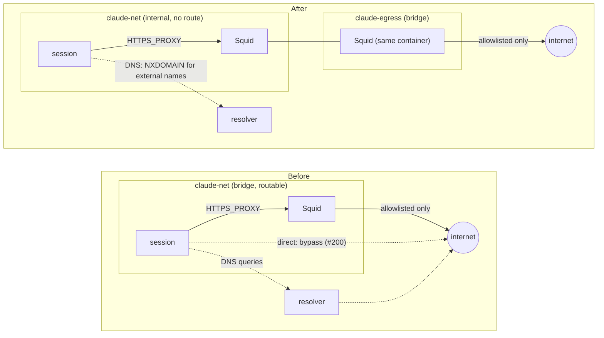

# Egress only through the proxy

## Status
Accepted

## Context

Issue #200. A session container reaches any host directly: `curl --noproxy
'*'` returned 200 from a host Squid refuses. `claude-net` is a plain bridge,
which routes outbound traffic, so Squid filters only clients that honor
`HTTPS_PROXY`. `0012-squid-proxy-integration.md` added the proxy and the
variables but nothing that removes the direct route.

Clients that ignore the variables include code the agent writes, a crate's
`build.rs` or proc macro (Change 29), npm lifecycle scripts and raw sockets.
A direct connection also leaves no access-log line.

`docs/claude-code-security-plan.md` §2.8 and `docs/squid-proxy-guide.md`
state the opposite of what is true.

### Topology, before and after

Before, there are two paths from a session to the internet, and only one of
them passes Squid:

1. session → Squid → internet, for clients that honor `HTTPS_PROXY`;
2. session → internet, directly, for every other client. This is #200.

After, there is one:

1. session → Squid → internet. The session's network, `claude-net`, has no
   route out; Squid is the only member of both networks.
2. DNS is a second possible way out. On an internal network the resolver
   does not answer external names (implementation step 1, decision 3).



## Decision

1. **Two networks.** `claude-net` becomes an internal network
   (`network create --internal`), which has no route out. A new network,
   `claude-egress`, is a plain bridge. Sessions join `claude-net` only. The
   proxy joins both: it is started on `claude-egress`, then connected to
   `claude-net` with `network connect`, which Podman and Docker both support
   on a running container. A failed connect aborts the launch (fail closed,
   as in 0012 §6.3).
2. **`start.sh` refuses a routable `claude-net`.** Before starting anything it
   reads `network inspect --format '{{.Internal}}'` (the same field in both
   engines) and aborts unless it is `true`, printing the commands that
   recreate it. An existing host is migrated by that message, not silently.
   `claude-egress` missing aborts the same way. The networks stay
   operator-created, as `claude-net` is today.

   The launch, in order. Steps 1 and 2 exit before anything starts; every
   exit after the proxy starts runs the existing `cleanup()` trap:

   1. `claude-net` missing, or not internal → abort, print the recreate
      commands.
   2. `claude-egress` missing → abort, print the create command.
   3. Start Squid on `claude-egress`; failure → abort (0012 §6.3).
   4. Connect Squid to `claude-net`; failure → abort, proxy removed.
   5. Start the session on `claude-net`.

   ```mermaid
   flowchart TD
       A["start.sh"] --> B{"claude-net exists<br/>and Internal = true?"}
       B -- no --> X1["abort: print recreate commands"]
       B -- yes --> C{"claude-egress exists?"}
       C -- no --> X2["abort: print create command"]
       C -- yes --> D["run Squid on claude-egress"]
       D -- fails --> X3["abort (fail closed)"]
       D -- ok --> E["network connect claude-net Squid"]
       E -- fails --> X4["abort; cleanup() removes Squid"]
       E -- ok --> G["run session on claude-net"]
   ```
3. **DNS is part of the route.** A resolver that forwards external names lets
   a session encode data in queries even with no TCP route. The session never
   needs to resolve an external name: with a proxy, the client sends the
   hostname inside `CONNECT`. Step 1 observed that on rootless Podman the
   internal network's resolver answers external names with NXDOMAIN, also
   when queried directly rather than through `resolv.conf` (see "Step 1
   result"). The session therefore needs no DNS flags. The test of
   decision 4 keeps the direct query, so a resolver that starts forwarding,
   on either engine, fails a test instead of reopening the path silently.
   If that happens, the fallback is the network's resolver disabled
   (`--disable-dns`) and the proxy's address passed with `--add-host`;
   `--dns` alone is not enough, because a session can query the network's
   resolver by address.
4. **Tested, not documented.** Two tests, both written first and seen
   failing on the current setup:
   - A container test, from a client on `claude-net`: a direct TCP
     connection to an IP literal fails with a connect error or timeout
     (curl exit 7 or 28), a direct connection by name fails, and a DNS
     query sent straight to the network's resolver returns no answer
     records. It asserts the absence of answers, not a particular rcode,
     since the engines' resolvers may reply differently.
   - A positive control in the same test: the same IP-literal probe from a
     client on `claude-egress` must succeed. Without it, a runner with no
     internet would pass the test; with it, that case is reported as
     inconclusive and never as a pass.
   - A host-only test of `start.sh`, with the engine stubbed as in
     `tests/test_config.bats`: a `claude-net` whose `Internal` is `false`
     aborts the launch before any container starts and prints the recreate
     commands.

   Proxy reachability by name and allowlist decisions need no new test: the
   S-group's clients move to `claude-net` and the test proxy is dual-homed,
   so S-1 to S-11 assert them on the topology a session has. Both CI floors
   rise with the new tests.

### Step 1 result

Rootless Podman on the operator's host (Podman version not recorded),
2026-11-26, with throwaway networks: `--internal` and a plain bridge, the
proxy started on the bridge then connected to the internal network, a
`claude-base` client on the internal network with `start.sh`'s security
flags.

| Probe, from the client | Result |
|---|---|
| `network inspect` of the internal network | `Internal=true`, `DNSEnabled=true` |
| Proxy name | resolves to its internal-network address |
| External name (`getent hosts docs.rs`) | no result |
| UDP query for `docs.rs` sent to the resolver in `resolv.conf` | `rcode=3` (NXDOMAIN), 0 answers |
| Direct HTTPS by name | curl exit 6 |
| Direct HTTPS to `1.1.1.1` | curl exit 7, immediately |
| Proxied, allowlisted host | HTTP 301; `TCP_TUNNEL/200` in the access log |
| Proxied, refused host (`docs.rs`) | curl exit 56; `TCP_DENIED/403` in the access log |

`docs.rs` exists, so an NXDOMAIN answer is read as the query not having
been forwarded upstream; that is an inference, not observed upstream.
Docker was not tested.

Open observation: the proxy's `resolv.conf` lists the internal network's
resolver first and the egress network's second, and `squid/squid.conf` sets
no `dns_nameservers`. Squid still resolved the allowlisted host. Not
explained; a likely cause is that aardvark-dns answers per requesting
container, and the proxy is a member of a non-internal network. If that
changes, Squid fails to resolve and the launch fails closed rather than
open. The S-group, run on the new topology, would surface it.

## STRIDE impact

| Threat | Change |
|---|---|
| **Information Disclosure (I)** | The direct route closes: egress is only via Squid's allowlist, which becomes the control the security plan says it is. DNS exfiltration closes too, as observed in step 1 and asserted by the test of decision 4. What remains is the existing blind-tunnel class through allowlisted hosts (Change 24). |
| **Repudiation (R)** | Every outbound connection now produces an access-log line, because there is no other way out. |
| **Tampering (T)** | Third-party code run in a session (`build.rs`, lifecycle scripts) can no longer fetch from arbitrary hosts. |
| **Denial of Service (D)** | A host on the old network cannot start a session until it recreates `claude-net`. Deliberate: running on it would be running without the control. |

Spoofing and Elevation of Privilege are unaffected. Sessions on `claude-net`
can still address each other, the pre-existing residual of 0012 §6.2-S.

**Residual:** the proxy is dual-homed, so it is now the only bridge between
the networks. A compromise of Squid is a compromise of egress policy, as it
already was for proxied traffic.

## Consequences

- The allowlist holds for every client, not only cooperative ones.
- Every existing host runs two network commands once; `start.sh` says which.
- Any tool that needed direct egress breaks, visibly. None is known; the
  spike and the S-group, run on the new topology, would surface one.
- One more network to create in CI and in `BUILDING.md`.
- Test setup grows: the test proxy needs the second network.

## Alternatives considered

**Chose:** an internal network with a dual-homed proxy.
**Rejected:** host firewall rules (nftables) dropping the session's
non-proxy traffic.
**Why it is attractive:** no topology change, works with the existing
network.
**What breaks:** rootless Podman's networking runs in a user namespace via
pasta or slirp4netns, so on the host the traffic leaves as the user's own
process rather than from a bridge address a rule can match; it needs root, and it lives outside the
repository, where no test sees it.

**Rejected:** `--network none` for the session and a Unix socket to the
proxy.
**Why it is attractive:** no network at all is the strongest isolation.
**What breaks:** clients speak HTTP proxy over TCP, not over a socket;
every tool would need a shim inside the container.

**Rejected:** keeping the bridge and documenting the allowlist as advisory.
**Why it is attractive:** no work.
**What breaks:** the allowlist stops being an Information Disclosure control,
and Change 29 just added a path (`build.rs`) that bypasses it.

## Implementation plan

Files expected to change. The concrete set is settled in implementation;
`squid/squid.conf` and `profiles/` are not expected to change.

| File | Change | Step |
|---|---|---|
| `start.sh` | Network checks; proxy dual-homed | 3 |
| `tests/test_squid_isolation.bats` | New direct-egress test with positive control; clients on `claude-net`, proxy dual-homed | 2, 4 |
| `tests/test_config.bats` | `start.sh` refuses a routable `claude-net` | 2 |
| `.github/workflows/ci.yml` | Raise `HOSTONLY_FLOOR` | 3 |
| `tests/lib/engine.bash` | `engine_ensure_network` creates `claude-net` internal and `claude-egress` | 4 |
| `.github/workflows/container.yml` | Create both networks; raise `CONTAINER_FLOOR` | 4 |
| `docs/designs/0011-claude-sandbox-testing-module-sdd.md` | Rows for the new tests | 2 |
| `docs/designs/0200-egress-only-through-the-proxy.md` | Step 1 result; decision 3 settled | 1 |
| `BUILDING.md`, `README.md` | Network setup commands | 5 |
| `docs/user-guide.md` | Troubleshooting entry for the refused network | 5 |
| `docs/claude-code-security-plan.md` | §2.8 states what is enforced | 5 |
| `docs/squid-proxy-guide.md` | Enforcement claim corrected | 5 |
| `docs/claude-code-security-plan-changelog.md` | Change 30, STRIDE delta | 5 |


1. Spike, not committed: done; see "Step 1 result". Decision 3 settled
   with no DNS flags.
2. `test:` the direct-egress test and the `start.sh` refusal test,
   committed before the fix and seen failing.
3. `fix(start):` `start.sh` checks both networks and dual-homes the proxy;
   `HOSTONLY_FLOOR` raised.
4. `test:` the S-group's topology moved to match; `engine_ensure_network`
   creates `claude-net` as internal; CI creates both networks; floor raised.
5. `docs:` `BUILDING.md`, user guide, security plan §2.8, Squid guide,
   changelog Change 30 (closes #200).
